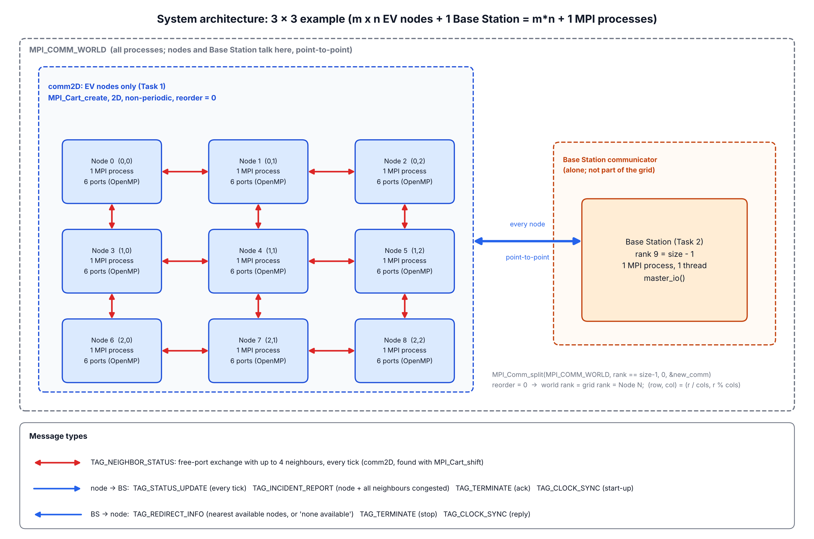
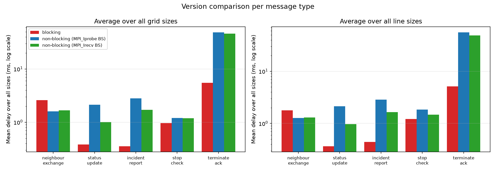

# ⚡ EV Charging Network Simulation (MPI + OpenMP)

A distributed simulation of a city's electric-vehicle charging network. Each charging station is its own **MPI process** arranged in a 2D grid, each charging port is an **OpenMP thread**, and a central **Base Station** redirects drivers away from congested areas. Two complete implementations, **blocking** and **non-blocking** communication, are benchmarked against each other across **639 runs** on grids of up to 81 nodes.



---

## ✨ What it simulates

- **Charging stations (EV nodes)** form an *m × n* **Cartesian grid** (`MPI_Cart_create`). Every 100 ms tick, each node updates its ports in parallel with OpenMP and swaps free-port counts with up to 4 neighbours (`MPI_Cart_shift`).
- **Incident reports.** When a node **and all its neighbours** are congested, it alerts the Base Station.
- **Base Station** tracks every node and replies with the **nearest stations that have free ports**, or "none available".
- **Information updates.** Nodes push status updates to the Base Station on a configurable period.
- **Clock synchronisation.** At start-up every node syncs its clock to the Base Station with **Cristian's algorithm**, so one-way delays can be measured accurately.
- **Clean shutdown** with a stop check (`MPI_Reduce` + `MPI_Bcast`) and terminate/acknowledge messages.

## 🔀 Three Base Station versions

| Version | How the Base Station receives |
|---|---|
| `blocking` | `MPI_Recv(MPI_ANY_SOURCE, MPI_ANY_TAG)`: waits for the next message |
| `nonblocking_iprobe` | Polls with `MPI_Iprobe`, then receives |
| `nonblocking_irecv` | Pre-posts an `MPI_Irecv` and tests it |

---

## 📊 Results

Every message type was timed with `MPI_Wtime` over **32 grid sizes** (2×2 up to 9×9), **32 line topologies** (1×2 up to 1×64) and several update periods, with 3 repeats each.



Key findings:
- **Neighbour exchange:** blocking delay **grows** with grid size (1.4 → 3.9 ms), while non-blocking stays almost **flat** (1.3 → 2.0 ms), because it posts all transfers at once and overlaps them.
- **Node → Base Station:** blocking is fastest at small sizes but **grows** as one process handles every node's messages in turn. Non-blocking delay is set by the **polling interval** and barely depends on size.
- **Processing is never the bottleneck.** The Base Station spends about 0.01 ms per message, so the delays are all communication and detection.
- **Line vs grid:** in a line, blocking waits chain along a single path, so delay grows even more steadily.

Full analysis: [`experiments/results/findings.md`](experiments/results/findings.md). All plots: [`experiments/results/plots/`](experiments/results/plots).

---

## 🚀 Build and run

Requires Open MPI and an OpenMP-capable C compiler.

```bash
mpicc -fopenmp -O2 ev_network_blocking.c    -o ev_network_blocking    -lm
mpicc -fopenmp -O2 ev_network_nonblocking.c -o ev_network_nonblocking -lm

# -np must be rows * cols + 1 (the extra process is the Base Station)
mpirun -np 10 ./ev_network_blocking 3 3                  # 3x3 grid
mpirun -np 10 ./ev_network_nonblocking 3 3 2000 8        # 2000 ms update period, 8 s run
mpirun -np 10 ./ev_network_nonblocking 3 3 500 4 irecv   # MPI_Irecv receive mode
mpirun -np 7  ./ev_network_blocking 1 6                  # line topology
```

On macOS, Apple's clang has no OpenMP. Use Homebrew LLVM: `OMPI_CC=$(brew --prefix llvm)/bin/clang mpicc ...`

Each run writes per-node availability logs, a Base Station log and a row in `comm_timing.csv`. Example output is in [`sample-output/`](sample-output).

### Re-running the experiments
```bash
bash experiments/run_sweep.sh all          # grid + line + period sweeps (~1 hour)
python experiments/plot_results.py         # regenerate the plots and summary tables
sbatch experiments/caas_job.slurm          # run on a SLURM HPC cluster
```

---

## 📁 Layout

```
ev_network_blocking.c       blocking EV nodes + blocking Base Station
ev_network_nonblocking.c    non-blocking EV nodes + Base Station (iprobe / irecv modes)
diagrams/                   architecture and flow diagrams (+ the script that draws them)
experiments/                sweep runner, SLURM job, plotting script, results and plots
sample-output/              example logs and timing data from one run
```

## 👥 Team
Built in a team of three.

## 🛠️ Tech
C · MPI (Cartesian topologies, point-to-point and collective communication) · OpenMP · SLURM · Python/matplotlib for analysis
